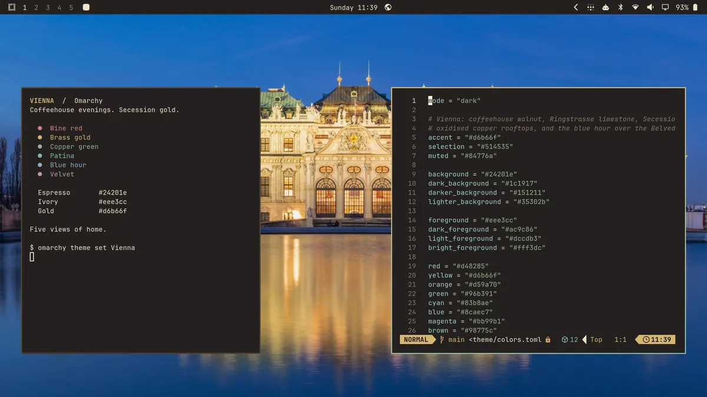

# Vienna

A dark Omarchy theme honoring Vienna: coffeehouse espresso and walnut,
warm limestone and ivory, Secession brass gold, copper green rooftops,
wine red, and blue hour at the Belvedere.

Uses Omarchy's generated application themes from colors.toml.



Wallpaper: Diego Delso, [delso.photo](https://delso.photo/),
[CC BY-SA 4.0](https://creativecommons.org/licenses/by-sa/4.0/).
[Photo source](https://commons.wikimedia.org/wiki/File:Palacio_Belvedere,_Viena,_Austria,_2020-02-01,_DD_93-95_HDR.jpg).
Preview: CC BY-SA 4.0; desktop compositing, crop, downsampling, and compression.
See [preview notices](preview.webp.license).


Five original-resolution Vienna photographs; see BACKGROUNDS.md for sources and credits.

## Install

```bash
omarchy theme install https://github.com/42lizard/omarchy-vienna-theme.git
```

To activate an already installed copy: `omarchy theme set Vienna`.
Cycle the five backgrounds: `omarchy theme bg next`.

Requires an Omarchy version supporting `colors.toml` theme generation.

## License

Original theme configuration and documentation: [MIT](LICENSE).
Third-party photographs: **CC BY-SA 4.0**, with individual credits below.

## Photograph licensing

The five bundled photographs are **CC BY-SA 4.0**, credited individually in
[BACKGROUNDS.md](BACKGROUNDS.md) and [backgrounds/README.md](backgrounds/README.md).
See [LICENSE.md](LICENSE.md) for scope and
[LICENSES/CC-BY-SA-4.0.txt](LICENSES/CC-BY-SA-4.0.txt) for the full license.
Keep these files in published releases. Caption photo previews with the relevant
photographer credit, source, license link, and any changes.

Only the five credited JPEGs are part of this theme. The retired, soft Belvedere
wallpaper is excluded because its redistribution rights were not verified.
